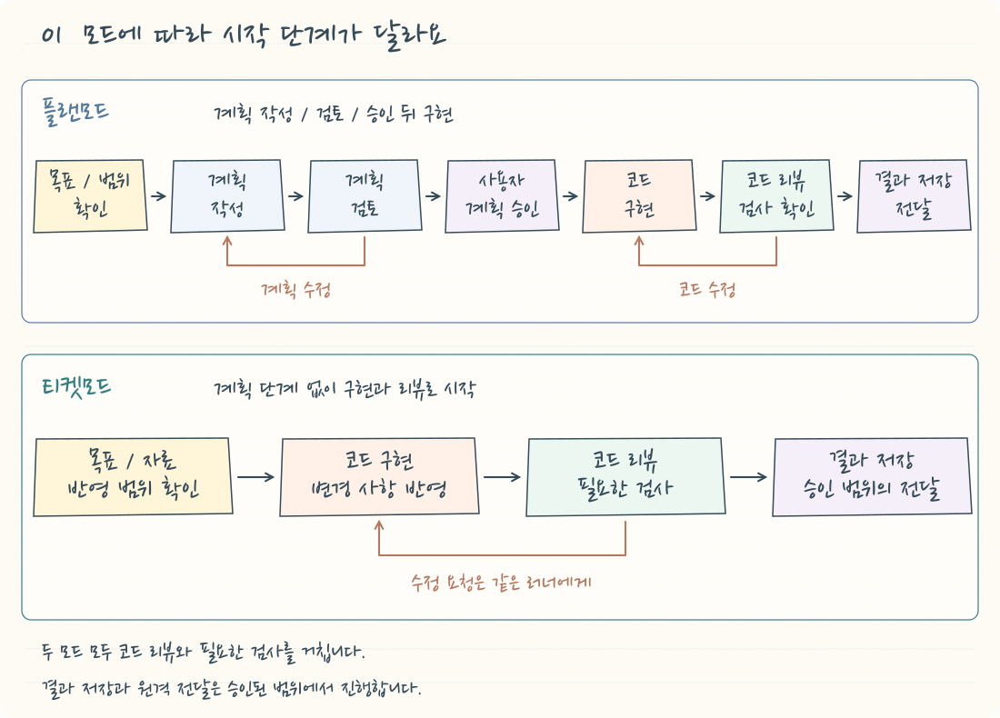
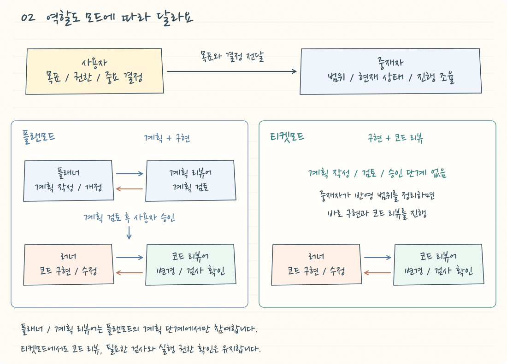
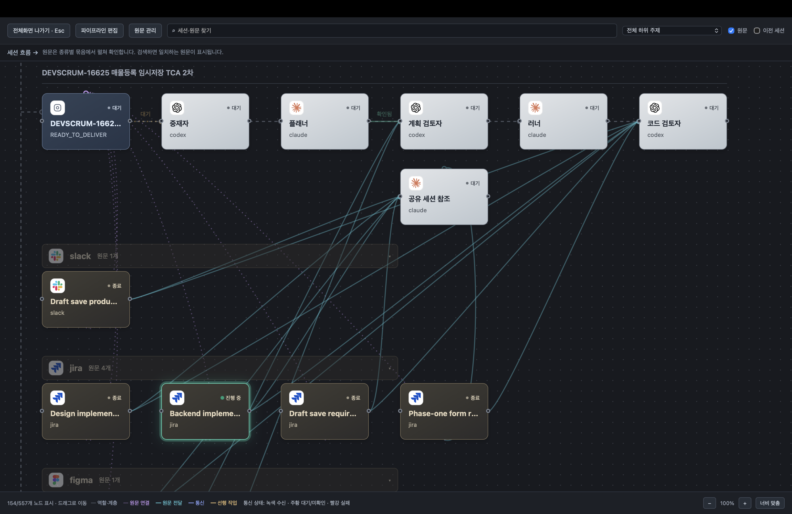

# Consensus Room

**Claude와 Codex가 계획하고, 구현하고, 서로 검토하는 과정을 관리하는 개발 작업 도구입니다.**

사람이 AI 사이에서 응답과 자료를 옮기는 수고를 줄이고, 누가 무엇을 근거로 작업했는지 기록합니다. 작업의 성격에 따라 두 가지 모드를 선택합니다.

| 모드 | 선택할 때 | 시작 지점 |
|---|---|---|
| **플랜모드** (`planned`) | 시간이 오래 걸려도 빠짐없이 완결해야 하는 리팩토링 | 계획 작성과 검토 |
| **티켓모드** (`ticket`) | 여러 원문의 요구사항 변경을 추적하며 구현하는 스프린트 작업 | 구현과 코드 리뷰 |

## 1. 플랜모드: 완결성이 중요한 리팩토링

**권장 작업:** 시간이 오래 걸리더라도 정한 범위를 빠짐없이 마무리하는 것이 중요한 리팩토링입니다. **Swift 6 리팩토링, 모듈화, 아키텍처 변경**이 대표적입니다.

서비스 요구사항 원문의 변경을 계속 따라가는 업무보다, 목표 구조와 완료 조건을 먼저 합의하고 전체 변경을 끝까지 검증하는 작업에 권장합니다.

1. 목표와 근거를 확인하고 여러 Markdown 파일로 계획을 작성합니다.
2. 플래너와 계획 리뷰어가 같은 역할 세션에서 작성·검토·개정을 이어 갑니다.
3. 리뷰어가 현재 판에 동의하면 사용자 승인을 기다립니다.
4. 승인한 계획으로 구현하고, 항목별 구현 보고와 코드 리뷰 판정을 확인합니다.
5. 검토한 변경을 커밋하고 승인된 범위에서 전달합니다.

엔진은 현재 계획과 승인한 판이 같은지, 계획에 선언한 항목이 구현 보고와 리뷰 판정에 빠지지 않았는지 확인합니다. 항목의 의미와 근거가 타당한지는 작업자와 리뷰어가 판단합니다.

중재자가 **계획 왕복 중 한 번 보류**를 요청할 수도 있습니다. 현재 턴은 끝까지 두고 결과를 저장한 뒤 다음 턴 전에 멈춥니다. 결정을 보태 재개하면 저장한 다음 지점에서 같은 세션으로 이어 갑니다.

> “Swift 6 리팩토링을 플랜모드로 진행해 줘. 의존 관계와 검증 순서를 먼저 정하고 빠짐없이 마무리해 줘.”

## 2. 티켓모드: 요구사항 변경을 추적하며 구현

**권장 작업:** Jira·Slack·Figma·백엔드 문서 등 **여러 곳에서 요구사항이 실시간으로 바뀌어, 변경 내역을 추적하면서 구현해야 하는 서비스 작업**입니다. 스프린트 작업이 대표적입니다.

1. 중재자가 목표·자료·반영 범위를 정리합니다.
2. 별도의 계획 합의·승인 단계 없이 구현을 시작합니다.
3. 코드 리뷰의 수정 요청을 같은 구현 세션으로 돌려보냅니다.
4. 변경 범위에 맞는 검사를 확인하고 결과를 커밋·전달합니다.

계획 해시와 계획 항목 선언은 요구하지 않습니다. **코드 리뷰, 권한 확인, 필요한 검증은 유지합니다.** 큰 설계 판단이 필요해지면 작업 방식 전환이나 계획 복귀를 명시적으로 선택할 수 있습니다.

Jira·Slack·Figma 등의 변경은 새 사실로 전달합니다. 영향은 작업자와 중재자가 판단하며, 자료가 바뀌었다는 이유만으로 작업 트리와 대화를 초기화하지 않습니다.

> “이번 스프린트의 주문 화면을 티켓모드로 구현해 줘. Jira·Slack·Figma의 요구사항 변경을 추적하고 반영 범위를 정리해 줘.”

## 두 모드의 공통 흐름

- **대화와 원문 보존:** 첫 턴에는 과제와 지침을, 다음 턴에는 상대 응답과 새 사실을 전달합니다. 긴 결정은 파일과 색인으로 남겨 문맥 압축 뒤에도 다시 읽을 수 있습니다. 같은 본문을 묶어도 순번과 출처는 유지합니다.
- **자료 선택과 누락:** 토픽·상위 토픽의 제목과 목표로 관련 위키를 고릅니다. 부족한 자료와 의존 작업은 후속 기록으로 남기고, 읽지 못한 자료를 확인했다고 처리하지 않습니다.
- **승인된 자동 진행:** 예약한 범위의 구현·리뷰·로컬 완료와 다음 단계 열기를 이어 갑니다. 재시작 뒤에도 현재 권한과 사용자 중지를 확인합니다. 다음 티켓 단계는 열어 두고 구현 시작을 기다립니다.
- **명시적인 복구:** 같은 세션으로 응답 형식을 한 번 교정하고, 세션 교체나 서버 밖 커밋의 구현 기준 채택은 공식 요청으로 기록합니다. 범위 전체를 초기화할 때는 현재 세대와 명시적 확인이 필요합니다.
- **완료와 전달 구분:** 리뷰한 코드의 커밋, 푸시, 묶음의 전달 확인, 제품 검수는 별개입니다. 전달 확인 API는 통합 결과가 로컬 원격 추적 ref에 포함됐는지 기록하며 fetch·push·merge를 대신하지 않습니다.
- **운영과 수리:** 실행 중인 턴을 끊지 않는 유휴 재시작과 수동 캐시 정리를 지원합니다. 소스·작업 트리·로그·테스트 결과를 보존합니다. 엔진 결함은 원장에 남기고 master가 별도 수리 작업을 배정합니다.

## 로그로 확인한 최적화

2026년 10월 15일 **같은 운영 DB 사본과 고정 시계**로 비교한 결과입니다. 9개 계산 결과의 해시는 모두 같았습니다.

| 비교 대상 | 수정 전 | 수정 후 | 감소율 |
|---|---:|---:|---:|
| 원문 186개의 관리 대상 계산 | 25.042초 | 1.072초 | **95.7%** |
| 같은 계산의 작업 묶음 DB 읽기 | 8,643회 | 185회 | **97.9%** |
| 재조회 대상 계산 | 2.877초 | 0.067초 | **97.7%** |

한 번의 동기 계산 안에서 같은 작업 묶음 데이터를 재사용해 반복 읽기와 JSON 파싱을 줄였습니다. 이 수치는 해당 계산의 처리 시간이며, 전체 개발 작업의 속도 향상률은 아닙니다.

전달량도 줄여 왔습니다. 9월 13일의 같은 결과를 만드는 계획 패치 실험은 **48,588 → 38,324바이트(21.1%)**, 10월 7일의 같은 캡처 입력 재계산은 계획 변경분을 **77,401 → 48,232바이트(37.7%)** 줄였습니다. 이후 옛 패치·계획 패커를 제거했고, 현재는 파일·diff와 결정 원문 색인을 사용합니다.

**바이트 감소를 토큰 절감률로 바꾸어 말하지 않습니다.** 10월 18일 추출한 최종 사용량 기록 565건 중 156건은 사용량이 부분 관측이었고, 작업·모델·수정 범위도 달랐습니다. 전체 시간과 토큰의 절감률에는 같은 조건의 실제 실행 비교가 필요합니다. 자세한 과정과 한계는 [포트폴리오 PDF](docs/consensus-room-portfolio.pdf)에 정리했습니다.

## 실제 화면

위쪽 카드는 역할과 상태, 아래쪽 카드는 연결 자료입니다. 점선은 연결 관계, 청록색 실선은 자료 전달 기록입니다. 전달 기록과 계획·결과 승인은 구분합니다.

## 시작 방법

연결된 Claude 또는 Codex 대화에서 목표와 사용할 모드를 전달합니다. 목표가 아직 정해지지 않았다면 논의부터 시작할 수 있습니다. **지시는 대화에서, 진행 확인은 웹 화면에서** 합니다.

[설치와 연결](docs/getting-started.md) · [목표·자료·논의로 시작하기](docs/topic-structure.md) · [사용량 집계 방법](docs/usage-report.md) · [설계와 운영 사례 PDF](docs/consensus-room-portfolio.pdf)

## 공개본 관리

이 저장소는 개발 저장소에서 검토한 파일만 옮긴 공개본입니다. 개인 운영 문서와 개발 이력은 포함하지 않습니다.
